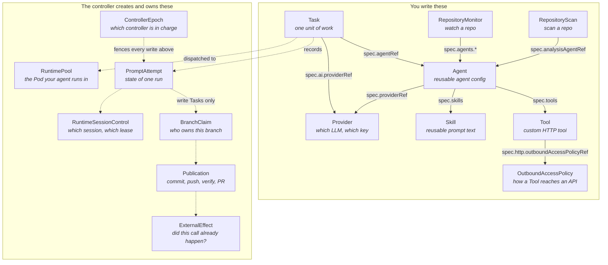
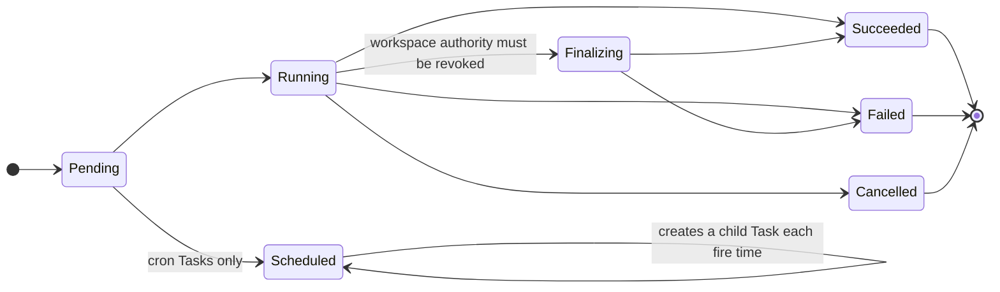
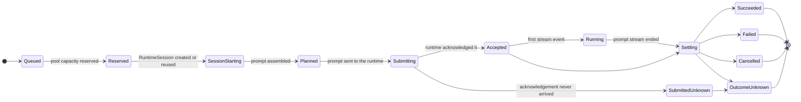

# Architecture

Orka is one controller that turns Task resources into work. Container and native AI Tasks run
as per-Task Kubernetes Jobs. Coding-agent Tasks run as private sessions in controller-owned
RuntimePools. Everything an agent produces flows back through the controller, which keeps a
durable record and, for code changes, hands the work to a separate publisher.

If you are new to Orka, read [What is Orka?](../overview.md) first. For the source tree and
storage internals, see [Controller internals](../development/internals.md).

## Overview

Select the diagram to view it at full size.

Requests arrive from the REST API, the CLI, the dashboard, chat, the OpenAI- and
Anthropic-compatible endpoints, gateways, and GitHub webhooks. The controller authenticates
them, creates or updates Tasks, and dispatches each Task to where it runs:

| Task type | Runs in | Reaches models through |
| --- | --- | --- |
| `container` | A per-Task Job from the general worker or your image | — |
| `ai` | A per-Task Job running Orka's AI worker | The Agent's Provider and its API key Secret |
| `agent` | A private RuntimeSession inside a RuntimePool Pod | The authenticated provider proxy and your model gateway |

Coding-agent runtimes and the Workspace/Publisher use separate network and credential
identities. A runtime Pod can reach only the provider proxy and its prompt-scoped tool broker;
it has no Git credentials and no route to your source control. The Publisher has the Git
credentials it needs for one operation at a time, and no access to models or tools.
[Security](security.md) explains the boundaries.

## Components

### Controller

The controller runs as a single-replica Deployment. It contains:

- **API server.** The REST API, chat, the OpenAI- and Anthropic-compatible endpoints, the
  gateway ingress, signed GitHub webhooks, internal worker APIs, and, when enabled, the
  [web dashboard](../guides/ui.md).
- **Task reconciler and priority queue.** Routes container and AI Tasks to worker Jobs, in
  priority order (0–1000), and coding-agent Tasks to the ACP dispatcher.
- **ACP dispatcher and RuntimePool controller.** Reserve pool capacity, run fenced prompt
  attempts, validate workspace changes, and manage digest-pinned, scale-to-zero runtime
  Deployments. [Agent runtimes](agent-runtimes.md) covers them in depth.
- **Brokers.** The credential and artifact brokers give the Publisher short-lived access for
  one operation. The prompt MCP broker rechecks every tool call a coding agent makes.
- **Workflow reconcilers.** Drive [repository monitors](../guides/repository-monitors.md),
  [security scans](../guides/repository-security-scanning.md), and
  [gateways](../guides/gateways.md), each with durable run history.
- **Stores.** Sessions, results, artifacts, plans, memory, scans, monitors, gateway ledgers,
  and usage live in an embedded SQLite database on a persistent volume. Control decisions for
  coding agents live in Kubernetes resources instead; see [Where state lives](#where-state-lives).

### Execution images

| Image | Description |
| --- | --- |
| **General Worker** (`workers/general/`) | Runs arbitrary container commands in a per-Task Job. |
| **AI Worker** (`workers/ai/`) | Runs native LLM/coordination Tasks in a per-Task Job. |
| **ACP Runtime** (`cmd/orka-acp-runtime`, `workers/acp/`) | Hosts multiple private Codex, Claude, Copilot, or OpenCode RuntimeSessions through `orka.harness.v2`; its per-session loopback proxy enforces provider routes and model selection. |
| **Provider Auth Proxy** (`cmd/orka-provider-auth-proxy`) | Authenticates traffic using the shared proxy credential and forwards it to Vekil. |
| **Workspace Publisher** (`cmd/orka-workspace-publisher`, `workers/publisher/`) | Uses a separate identity for clean-room clone, commit preparation, exact-ref publication, independent verification, and PR reconciliation. |

## Custom resources

Orka installs 29 custom resources. You write a few of them; the controller creates and owns
the rest to keep track of work across restarts and failures.

Solid arrows are references you type. Dotted arrows are relationships the controller maintains —
you can read them with `kubectl get`, but you never create or edit those objects yourself.

### The resources you write

| Resource | Purpose |
|-----|---------|
| **Task** | One unit of work: container, AI, or agent |
| **Agent** | Reusable configuration: model, prompt, tools, skills, and optionally a runtime |
| **Provider** | A model backend and its API key Secret |
| **Skill** | Reusable prompt content injected into an Agent's system prompt |
| **Tool** | A custom tool backed by an HTTP endpoint or an MCP server |
| **OutboundAccessPolicy** | How a Tool reaches an external API. See [Outbound access](outbound-access.md) |
| **RepositoryScan** | A repository to scan for security findings |
| **RepositoryMonitor** | A repository whose pull requests and issues agents review, implement, and repair |
| **ConnectorProvider** | An OAuth service people may link. Each person's link is a **Connection**, which the API creates for them. See [Connectors](../guides/connectors.md) |
| **AgentRuntime** | An external agent runtime registration. See [Bring your own agent runtime](../guides/bring-your-own-agent-runtime.md) |
| **SubstrateActorPool** | A pool of Agent Substrate actors |
| **GatewayClass**, **Gateway**, **GatewayBinding** | Connect chat apps and other agents (`gateway.orka.ai`). See [Gateways](../guides/gateways.md) |
| **ExecutionWorkspaceClass** and related resources | Sandboxed execution workspaces (`workspace.orka.ai`) from separately installed providers. Off by default. See [Execution workspaces](execution-workspaces.md) |

Every field is in the [Resource reference](../reference/resources.md).

### The resources the controller owns

Read them when you are debugging. Do not edit them.

| CRD | Purpose |
|-----|---------|
| **RuntimePool** | Controller-owned logical pool for one trust domain and immutable built-in ACP profile |
| **ControllerEpoch** | Current controller holder/epoch and takeover fence |
| **PromptAttempt** | Durable ACP execution/delivery state for one Task attempt |
| **RuntimeSessionControl** | Logical Session lifecycle, exact runtime identity, and mutation lease state |
| **BranchClaim** | Compare-and-swap ownership/baseline for one publication branch |
| **Publication** | Prepared commit, push, verification, and optional PR reconciliation state |
| **ExternalEffect** | Idempotency and reconciliation ledger for consequential brokered calls |

## Task lifecycle

There are two lifecycles, and they are not the same thing.

The first is the **Task phase** — what `kubectl get task` prints, and what the UI shows. Every
Task has one, whatever its type:

Native and container Tasks without an execution workspace can complete directly from
`Running` to `Succeeded` or `Failed`. `Finalizing` is used when execution-workspace
authority still needs revocation.

The second is the **attempt state** — the fine-grained record of one agent run. Native `ai` and
container Tasks do not have one; they use the worker Job lifecycle instead. Built-in
`type: agent` Tasks record every step in a `PromptAttempt`:

Two details the diagram compresses:

- Every state before `Accepted` can also jump straight to `Failed` or `Cancelled`. The arrows are
  left out so the happy path stays readable.
- `SubmittedUnknown` means Orka sent the prompt and never learned whether the runtime got it. It
  can only become `OutcomeUnknown` — never `Succeeded` and never a retry. Orka would rather leave
  you with an honest "I don't know" than run your prompt twice.

The selected RuntimePool scales from `Stopped` through `Starting` to `Serving/Accepting`. The dispatcher creates or reuses a private RuntimeSession, starts one non-reconnectable prompt stream, renews its lease, and records bounded events. A prompt that may have been accepted is never automatically replayed.

After prompt settlement, the RuntimeSession enters validation. Read Tasks succeed only after the final tree matches the verified baseline. Write Tasks with changes proceed through clean-room preparation, exact-ref publication, independent verification, optional PR reconciliation, and finalization. The controller settles the Kubernetes control records and SQLite transcript/outbox payloads before projecting terminal Task status.

The top-level Task phase, `status.execution`, and `status.delivery` are safe compatibility/read-model projections. The authoritative ACP transitions live in `PromptAttempt`, `RuntimeSessionControl`, `BranchClaim`, `Publication`, `ExternalEffect`, `RuntimePool.status`, and the associated coordination Leases.

## How the features fit together

- **Delegation.** A coordinator Agent creates child Tasks with `delegate_task` and collects
  them with `wait_for_tasks`. The controller enforces the allowed Agents, depth, and
  concurrency, and records progress in the parent's `status.childTasks`. In autonomous mode,
  the controller reruns the coordinator in a loop, carrying a saved plan between iterations.
  See [Multi-agent coordination](../guides/multi-agent-coordination.md) and
  [Autonomous tasks](../guides/autonomous-tasks.md).
- **Sessions.** Tasks that share a Session run one at a time and see the earlier
  conversation. Sessions store user and assistant messages only, so a conversation can move
  between native AI and coding-agent Tasks. A coding agent's session is rebuilt from that
  canonical transcript and the verified workspace when its Pod is replaced.
- **Tools.** Native AI Tasks get [built-in tools](../reference/built-in-tools.md) and custom
  [Tools](../reference/resources.md#tool). Coding agents use their CLI's tools, plus Orka tools
  through the per-session broker.
- **Memory.** AI workers load a bounded set of reviewed, namespace-scoped memories into the
  system prompt. Agents can only propose new memories; a person reviews and applies them.
  See [Memory](memory.md).
- **Repository automation.** Repository monitors and security scans run their work as
  ordinary Tasks and keep runs, findings, reviews, and audit events in SQLite. Status on the
  resource summarizes them; the API and dashboard show the detail.
- **Gateways.** An out-of-tree adapter normalizes each external conversation into an
  `orka.gateway.v1` event. A GatewayBinding maps it to one Agent, and unknown or ambiguous
  identity fails closed. A durable inbox and outbox decouple acknowledgement from execution,
  deduplicate events, serialize each Session, and deliver replies with stable idempotency IDs.
  See [Gateways](../guides/gateways.md) and the [Gateway API](../reference/gateway-api.md).

## Where state lives

Orka needs no external database. It keeps two kinds of state:

- **Kubernetes resources and Leases** are the authority for coding-agent control decisions:
  which controller is in charge, attempt state, Session ownership, branch claims,
  publications, and external effects. Updates use `resourceVersion` compare-and-swap, so a
  stale writer cannot win.
- **SQLite on the controller's volume** holds payloads and records: results, artifacts (up to
  10 MB each), sessions and transcripts, plans, memory, scan and monitor history, gateway
  inbox and outbox, and usage. It is written behind the Kubernetes fences and never acts as
  a second authority.

Back up both together, with the snapshot encryption key. See [Upgrading](../operations/upgrading.md).

## Design decisions

| Area | Decision | Rationale |
|------|----------|-----------|
| **Result Storage** | SQLite (embedded) | No size limit, zero external dependencies, pure Go via `modernc.org/sqlite`. |
| **Session Storage** | SQLite (embedded) | Normalized schema with efficient querying and pagination. No size limit. |
| **Plan Storage** | SQLite (embedded) | Persists autonomous coordination plan state across iterations. |
| **Memory Storage** | SQLite (embedded) | Persists durable memories and reviewable memory proposals for namespace-scoped recall. |
| **Artifact Storage** | SQLite stores artifact metadata and BLOB content, 10MB max per artifact. | Keeps worker outputs co-located with task/session state while bounding per-artifact size. |
| **ACP Control Authority** | Kubernetes CRD status + coordination Leases | `resourceVersion` CAS and Leases provide shared/watchable epoch, attempt, Session, branch, publication, and external-effect fencing. |
| **ACP Payload/Outbox Storage** | SQLite behind Kubernetes fences | Stores transcript/SessionTurn payloads and deferred outbox projections without becoming a second control authority. |
| **Security Scan Storage** | SQLite stores repository scan runs, threat models, findings, and patch proposals. | Provides durable repository-security history without an external database. |
| **API Authentication** | Kubernetes ServiceAccount tokens plus optional OIDC JWT and generic context-token validation. | Native K8s auth by default; OIDC and `transaction-token` TxTokens support external/request-scoped API clients. |
| **Task Queue** | Priority queuing (0-1000) | Higher priority tasks are scheduled first. |
| **Secret Management** | Reference Kubernetes Secrets by role | Native workers receive only required Secrets. ACP source-read, target-read, target-write, forge, provider-proxy, publisher-auth, and capability roles stay separate; Git/forge values are brokered only to the clean-room Publisher. |
| **Observability** | Prometheus metrics, structured logs, optional OpenTelemetry traces and GenAI OTLP metrics. | Standard K8s metrics/logging with opt-in distributed tracing and model/tool latency telemetry. |
| **AI Tools** | Built-in + extensible via CRDs | Ship with categorized built-in tools and can be extended via Tool CRDs. |
| **Failure Policy** | Configurable retry with backoff | `spec.retryPolicy` with max retries and exponential backoff. |
| **Session Execution** | Serial per session | Tasks sharing a session run one-at-a-time to prevent race conditions. |
| **Worker Security** | Hardened pods | Non-root, read-only rootfs, all capabilities dropped, seccomp RuntimeDefault. |

