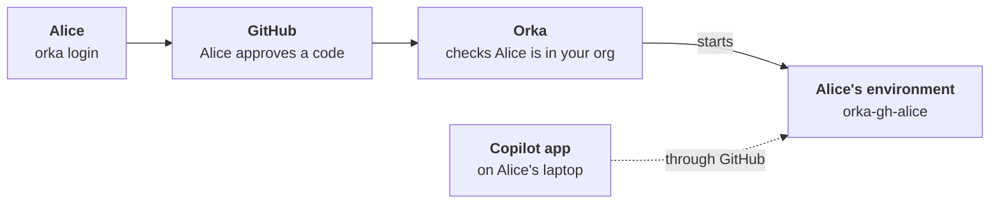

# Copilot app on Orka

The GitHub Copilot desktop app can run its agent on another machine instead of your laptop.
Orka gives each person on your team that machine: their own **environment** on your Kubernetes
cluster, with its own disk, that keeps running while their laptop sleeps. Copilot clones
repositories, runs commands and keeps its sessions there.

You set it up once. After that, each person joins with one command:

```text
$ orka login --server https://orka.example.com
Signing in starts your Copilot environment on Orka. Code running there can read your GitHub token.
Open https://github.com/login/device and enter the code WDJB-MJHT
Signed in to https://orka.example.com as alice.
Waiting for your agent host...
Host ready: orka-gh-alice. Pick it in the Copilot app's Environments.
```

Nobody needs Kubernetes access, writes YAML or copies a token around.

## How it works



1. **Alice signs in with GitHub.** `orka login` shows a short code, and she approves it on
   github.com.
2. **Orka checks she belongs.** Only active members of the GitHub orgs or teams you allow get in.
3. **Orka starts her environment** and keeps its GitHub token fresh from then on.
4. **She picks it in the Copilot app.** The app reaches the environment through GitHub, so your
   cluster needs no extra inbound connection for it.

:::warning[An environment is as trusted as a laptop]
Each environment belongs to one person and holds their GitHub token. Anything that runs inside
it, including code from the repositories they open, can read that token and make HTTPS
requests to the internet. Give environments to people you would trust with that access on their
own laptop.
:::

## What you need

**To set it up, once:**

- A Kubernetes cluster where you can install Orka with Helm. [Install Orka](../operations/installation.md)
  covers the basics.
- A GitHub organization your team belongs to, and permission to create a GitHub App in it.
- An HTTPS address your team can reach: a domain with an Ingress, or
  [Tailscale](https://tailscale.com/kb/1236/kubernetes-operator) if you have no domain.

**To join, for each person:**

- Membership in that GitHub organization.
- The GitHub Copilot desktop app.
- The `orka` CLI: `brew install orka-agents/tap/orka`, or a download from
  [GitHub Releases](https://github.com/orka-agents/orka/releases). See
  [CLI installation](../reference/cli.md#installation).

:::tip[Just trying it out?]
You can skip the address for now. Forward the API to your machine with
`kubectl -n orka-system port-forward svc/orka 8080:8080` after you install, use
`http://localhost:8080` wherever this guide says `https://orka.example.com`, and leave out the
`ingress` block. Only you can sign in this way, but it is a quick way to see the whole flow.
:::

## Step 1: Create a GitHub App

The app is how people sign in, and its permissions decide what each environment can do on
GitHub.

In your organization, open **Settings → Developer settings → GitHub Apps → New GitHub App**.
Create it under the organization, not your personal account: a private app can only be
installed, and signed in with, by the account that owns it.

| Setting | Value |
| --- | --- |
| GitHub App name | Something your team will recognize, such as "Acme Orka". People see it when they approve their sign-in. Leave "GitHub" and "Copilot" out, so it isn't mistaken for an official app. |
| Homepage URL | Your Orka address, such as `https://orka.example.com`. |
| Callback URL | `https://orka.example.com/api/v1/connections/callback` |
| Expire user authorization tokens | On |
| Request user authorization (OAuth) during installation | Off |
| Enable Device Flow | On |
| Webhook → Active | Off. Orka doesn't use it. |
| Where can this GitHub App be installed? | Only on this account |

Then set its permissions:

| Permission | Access | Why |
| --- | --- | --- |
| Organization → Members | Read-only | Required. Orka checks each person is a member of your org. |
| Repository → Contents | Read and write | Clone, commit and push. Choose Read-only if agents should only read code. |
| Repository → Pull requests | Read and write | Open and update pull requests. |
| Repository → Metadata | Read-only | GitHub adds this one for you. |

Add Issues or Workflows only if you want agents to work with them. Code running in an
environment can use every permission you grant here, so keep the list short.

Create the app, then:

1. Copy the **Client ID** from the app's **General** page.
2. Click **Generate a new client secret** and copy it. GitHub shows it only once.
3. Open **Install App**, install the app on your organization, and choose the repositories
   your team will work on.

:::tip[What can each environment reach?]
An environment works on GitHub as its person, through this app. It reaches a private
repository only when the app is installed on it **and** that person has access to it, and it
never gets more access than the person already has. Public repositories can always be cloned
and read.
:::

:::note[No private key needed]
Orka uses only the client ID and secret. If you generate a private key for the app anyway, keep
it safe: whoever holds it can act as the app on every repository it is installed on.
:::

## Step 2: Install Orka

Store the client secret in the cluster:

```bash
kubectl create namespace orka-system
kubectl -n orka-system create secret generic github-app \
  --from-literal=clientSecret='<client secret>'
```

Environments run a small helper from the Orka image, pinned to an exact build. Look up that
build's digest for the chart you are about to install:

```bash
helm repo add orka https://orka-agents.github.io/orka/charts
helm repo update orka
VERSION=$(helm show chart orka/orka | sed -n 's/^appVersion: "*v*\([^"]*\)"*/\1/p')
docker buildx imagetools inspect "ghcr.io/orka-agents/orka:$VERSION" --format '{{json .Manifest.Digest}}'
```

Save these values as `orka-values.yaml`, filling in your client ID, the digest, your
organization and your address:

```yaml
controller:
  image:
    digest: sha256:<digest from above>
  connectors:
    enabled: true
    callbackBaseUrl: https://orka.example.com
  agentHosts:
    enabled: true
    github:
      enabled: true
      clientID: <client ID>
      clientSecret:
        existingSecret: github-app
  githubSignIn:
    enabled: true
    allowedOrgs: [acme]          # or allowedTeams: [acme/platform]

ingress:
  enabled: true
  className: nginx
  host: orka.example.com
  tls:
    - hosts: [orka.example.com]
      secretName: orka-tls
```

:::tip[No domain? Use Tailscale]
With the [Tailscale Kubernetes operator](https://tailscale.com/kb/1236/kubernetes-operator)
installed, replace the `ingress` block with:

```yaml
ingress:
  enabled: true
  className: tailscale
  tls:
    - hosts: [orka]
```

Orka is then served at `https://orka.<your-tailnet>.ts.net` to everyone on your tailnet. Use
that address for `callbackBaseUrl` and in the app's callback URL.
:::

Install:

```bash
helm install orka orka/orka --namespace orka-system --create-namespace \
  -f orka-values.yaml --wait --timeout 10m
```

Check that Orka offers GitHub sign-in:

```bash
curl https://orka.example.com/api/v1/auth/config
```

```text
{"oidc":false,"github":{"clientID":"<client ID>","agentHost":true}}
```

## Step 3: Bring in your team

Send your team one line:

> Install the `orka` CLI and the Copilot desktop app, then run
> `orka login --server https://orka.example.com`.

Here is what each person sees:

1. A reminder that code in their environment can read their GitHub token.
2. A link and a code. Their browser opens github.com/login/device; they sign in as themselves,
   enter the code and approve.
3. `Host ready: orka-gh-<login>` within a minute or so.
4. In the Copilot app, under **Environments**, they pick `orka-gh-<login>` and start working.

The environment name is `orka-gh-` followed by the person's GitHub login in lowercase. An
underscore becomes two hyphens, so `alice_acme` gets `orka-gh-alice--acme`.

### Invite someone who can't reach Orka

Some people can't reach your Orka address, or only want the Copilot app. An admin with
Kubernetes access can invite them, and they need nothing but a browser and the app.

First, let the `orka-client` ServiceAccount, which the Helm chart created, send invites. You
only do this once:

```bash
kubectl apply -f - <<'EOF'
apiVersion: rbac.authorization.k8s.io/v1
kind: Role
metadata:
  name: agent-host-inviter
  namespace: orka-system
rules:
  - apiGroups: ["core.orka.ai"]
    resources: ["agenthosts"]
    verbs: ["create"]
---
apiVersion: rbac.authorization.k8s.io/v1
kind: RoleBinding
metadata:
  name: agent-host-inviter
  namespace: orka-system
roleRef:
  apiGroup: rbac.authorization.k8s.io
  kind: Role
  name: agent-host-inviter
subjects:
  - kind: ServiceAccount
    name: orka-client
    namespace: orka-system
EOF
```

Then invite them by their GitHub login:

```bash
orka host invite alice --server https://orka.example.com \
  --token "$(kubectl -n orka-system create token orka-client)"
```

```text
Ask alice to open https://github.com/login/device and enter the code WDJB-MJHT before 3:42PM.
Tell them first: approving starts their Copilot environment on Orka, and code running there can read their GitHub token.
alice accepted: linked; Orka is starting their Copilot environment.
```

Pass the code on, together with that warning. A few things to know:

- The code works once, for 15 minutes, and only for the invited account. If someone else
  approves it, Orka turns it away.
- Run the command again for a fresh code. Pending invites don't survive a restart of Orka.
- Invited people can't manage their environment themselves, but there is nothing to manage day
  to day: environments stay on.
- If they run `orka login` later, they get the same environment back.

## Day to day

| To | Run |
| --- | --- |
| See your environment, and why it isn't ready | `orka host status` |
| Wake it, if your admin turned on idle suspension | `orka host wake` |
| Start over with an empty disk | `orka host delete --yes`. A fresh one follows while GitHub stays linked. |
| See your GitHub link | `orka connection list` |
| Sign out of the CLI | `orka logout`. Your environment keeps running. |

Good to know:

- **Your sign-in lasts 12 hours** and renews itself whenever you use `orka` in its last two
  hours. If it lapses, run `orka login` again and you get the same environment.
- **Your environment doesn't depend on the CLI.** It keeps working in the Copilot app while you
  are signed out, and Orka refreshes its GitHub token on its own.
- **When someone leaves your org**, they can't renew, so their sign-in ends within 12 hours.
  Their environment stops at its next GitHub token refresh, within 8 hours, and its disk is
  kept.

## Troubleshooting

| What you see | What to do |
| --- | --- |
| `... does not offer GitHub sign-in` | Check the server address, and that `controller.githubSignIn.enabled` is `true`. |
| `could not check your GitHub membership; retry` | The app can't read your org's members. Give it **Organization → Members: Read-only**, install it on the org named in `allowedOrgs`, and accept the new permission on every existing installation. |
| `you are not an active member of a GitHub org or team allowed to sign in` | Join the org, or accept your pending invitation to it. Admins: check `allowedOrgs` and `allowedTeams`. |
| Your org isn't listed under **Install App** | The app is private to another account. Create it under the organization, or make it public in the app's **Advanced** settings. |
| `unknown command "login"` or `unknown command "host"` | Your `orka` CLI is older than your Orka. Upgrade it. |
| Copilot can't clone a private repository | Install the app on that repository, and check the person has access to it. |
| Copilot can't push or open a pull request | Give the app **Contents** and **Pull requests** Read and write, then accept the change on each installation. |
| `orka host invite` answers 403 | Apply the Role in [Invite someone who can't reach Orka](#invite-someone-who-cant-reach-orka). |
| `helm install` says the agent image must be pinned | Set `controller.image.digest` as shown in [Step 2](#step-2-install-orka). |
| The environment isn't ready | `orka host status` says why. [Agent hosts](../operations/agent-hosts.md#troubleshooting) lists every reason. |
| The environment is ready, but the Copilot app says `Mission Control connect failed (HTTP 403)` | GitHub blocks the whole environment while one of its sessions is in a repository you can no longer push to, such as an archived one. [The Copilot app cannot connect](../operations/agent-hosts.md#the-copilot-app-cannot-connect) shows how to get back in. |

## Learn more

[Agent hosts](../operations/agent-hosts.md#hosts-from-github-connections) is the full
reference: how tokens are held and refreshed, who may sign in, suspension and wake, custom
templates, and every setting behind this guide.
