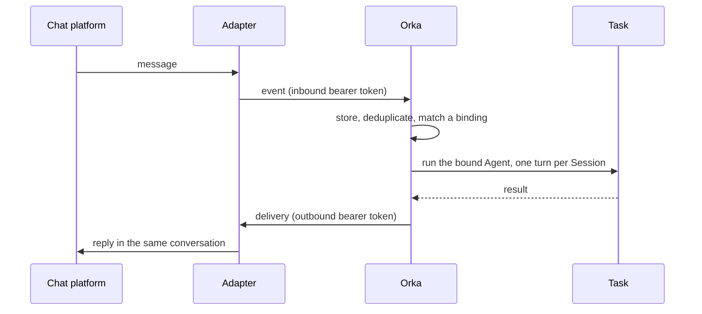

# Gateways

A gateway lets people and other systems talk to an Orka Agent from where they already work:
a Microsoft Teams chat, a Telegram conversation, or another agent that speaks
[A2A](https://a2a-protocol.org/). A message arrives, Orka runs the bound Agent as an ordinary
Task, and the reply goes back to the same conversation. Follow-up messages continue the same
Session.

Orka never talks to Teams or Telegram itself. A small **adapter**, deployed next to Orka, owns
the platform's SDK and credentials and speaks one neutral protocol, `orka.gateway.v1`, to
Orka. Orka owns everything after that: deciding who may talk to which Agent, queueing work per
conversation, running the Task, and delivering the reply.

:::tip[Video demo]
Watch [Agent-to-agent requests with safe retries](https://www.youtube.com/watch?v=2shxIt1ooxE).
:::

## Adapters

| Adapter | What it connects |
| --- | --- |
| [orka-gateway-teams](https://github.com/orka-agents/orka-gateway-teams) | Microsoft Teams personal chats and opt-in shared rooms, with replies as Adaptive Cards |
| [orka-gateway-telegram](https://github.com/orka-agents/orka-gateway-telegram) | Telegram private chats |
| [orka-gateway-a2a](https://github.com/orka-agents/orka-gateway-a2a) | Any A2A client, with Agent Card discovery and `GetTask` polling |

Each adapter is versioned separately and documents the Orka versions it supports. To connect
another system, implement the [`orka.gateway.v1` protocol](https://github.com/orka-agents/orka/blob/main/docs/development/gateway-protocol-v1.md).

## How a message flows



- **Accepted means durable.** Orka stores an event before acknowledging it, so accepted work
  survives restarts, and a repeated external event ID is recognized instead of run twice.
- **One turn at a time.** Messages for a busy Session wait in order.
- **Unknown means no.** An unknown conversation, a sender who is not allowed, or two equally
  specific bindings is rejected. Orka sends a generic denial when it can, and creates no Task.
- **Text stays out of the Task.** The message lives in the Session transcript; the Task
  resource carries only safe correlation metadata.
- **Retries are safe.** Deliveries keep a stable idempotency ID across retries, so a
  conforming adapter never posts the same reply twice.
- **Progress updates are optional.** An adapter that supports interim messages lets the agent
  post bounded updates while it keeps working.

Gateway Tasks are ordinary Tasks: a native AI Agent produces a `type: ai` Task, and an Agent
with a runtime produces a `type: agent` Task.

## Set up a gateway

Gateways are enabled by default. Create everything in the namespace the controller watches.
The manifests below are adapted from the samples in
[`config/samples`](https://github.com/orka-agents/orka/tree/main/config/samples); follow your
adapter's own guide for deploying the adapter itself.

### 1. Declare the protocol

A `GatewayClass` is cluster-scoped. It names the protocol and the capabilities a Gateway's
adapter must advertise before Orka considers it ready. Require only what your adapter
supports: this class leaves out `threads`, which the Telegram adapter does not advertise, so
it works with any of the adapters above. Add `threads: true` for thread-aware adapters and
`thread` or `thread-sender` Session modes.

```yaml
apiVersion: gateway.orka.ai/v1alpha1
kind: GatewayClass
metadata:
  name: generic-chat
spec:
  contractVersion: orka.gateway.v1
  category: chat
  capabilities:
    inboundText: true
    outboundText: true
    senderIdentity: true
    idempotentDelivery: true
  allowedMetadataKeys:
    - tenantTier
```

### 2. Create the bearer Secrets

Orka and the adapter authenticate each other with two separate tokens. The inbound token is
what the adapter sends to Orka; the outbound token is what Orka sends to the adapter. Each
Secret must opt in with a label and name its Gateway, and the outbound Secret must also name
the exact adapter endpoint, so a changed Service cannot redirect the token:

```bash
umask 077
openssl rand -hex 32 > external-chat-inbound.token
openssl rand -hex 32 > external-chat-outbound.token

kubectl -n orka-system create secret generic external-chat-inbound \
  --from-file=token=external-chat-inbound.token
kubectl -n orka-system label secret external-chat-inbound gateway.orka.ai/inbound-auth=true
kubectl -n orka-system annotate secret external-chat-inbound gateway.orka.ai/gateway-name=external-chat

kubectl -n orka-system create secret generic external-chat-outbound \
  --from-file=token=external-chat-outbound.token
kubectl -n orka-system label secret external-chat-outbound gateway.orka.ai/outbound-auth=true
kubectl -n orka-system annotate secret external-chat-outbound \
  gateway.orka.ai/gateway-name=external-chat \
  gateway.orka.ai/adapter-endpoint=https://external-chat-adapter.orka-system.svc:8090
```

Give the adapter the same two token values through its own configuration, then delete the
two token files. Writing the tokens to owner-only files keeps them out of process arguments.

### 3. Point at the adapter

```yaml
apiVersion: gateway.orka.ai/v1alpha1
kind: Gateway
metadata:
  name: external-chat
  namespace: orka-system
spec:
  gatewayClassName: generic-chat
  adapter:
    # This Service must terminate TLS for external-chat-adapter.orka-system.svc.
    serviceRef:
      name: external-chat-adapter
      port: 8090
  inboundAuthRef:
    name: external-chat-inbound
    key: token
  outboundAuthRef:
    name: external-chat-outbound
    key: token
```

The adapter must serve HTTPS. With `serviceRef`, its certificate must be valid for
`<service>.<namespace>.svc` and trusted by the controller; for a private CA, see
[`serviceRef` TLS and private CAs](../operations/gateways.md#serviceref-tls-and-private-cas).
An adapter outside the cluster uses `adapter.endpoint` with a public HTTPS URL instead.

### 4. Bind conversations to an Agent

A `GatewayBinding` decides which conversations reach which Agent, who may talk, and how
messages map to Sessions:

```yaml
apiVersion: gateway.orka.ai/v1alpha1
kind: GatewayBinding
metadata:
  name: support-room
  namespace: orka-system
spec:
  gatewayRef:
    name: external-chat
  agentRef:
    name: assistant
  match:
    accountId: example-account
    contextId: support-room
  senderPolicy:
    mode: allowlist
    allowedSenderIds:
      - operator-1
  priority: 100
  session:
    mode: context-sender
  taskDefaults:
    timeout: 15m
    retryPolicy:
      maxRetries: 1
      backoffMultiplier: 2
  activeTurnBehavior: queue
```

| Field | What it decides |
| --- | --- |
| `match` | The exact `accountId` and `contextId`, plus optional `threadId` and `senderId`, this binding handles. |
| `senderPolicy` | `allowlist` (the default) admits only `allowedSenderIds`. `all` admits anyone in a trusted context. |
| `priority` | The highest-priority authorized binding wins. Two matches at the same priority fail closed. |
| `session.mode` | Which messages share a Session: `ephemeral`, `context`, `thread`, `sender`, `context-sender`, `thread-sender`, or `explicit`. |
| `taskDefaults` | Bounded `timeout`, `priority`, `retryPolicy`, and, for runtime Agents, `agentRuntimeMaxTurns`. |
| `activeTurnBehavior` | `queue`: new messages wait for the current turn. |

### 5. Check readiness

```bash
kubectl -n orka-system get gateways,gatewaybindings
orka gateway list
orka gateway binding list
```

A Gateway is ready only after its Secrets resolve, the adapter answers authenticated health
and capability probes, and its capabilities satisfy the GatewayClass. The dashboard's
**Gateways** page shows readiness, bindings, per-Session queues, event timelines, and
delivery attempts. To find the Tasks a gateway created, select on the
`gateway.orka.ai/gateway` label.

## Next steps

- [Operating gateways](../operations/gateways.md): service levels, interim replies, dead
  letters and retries, backup and restore, and upgrades.
- [Gateway API](../reference/gateway-api.md): resources, REST endpoints, and CLI commands.
- [`orka.gateway.v1` protocol](https://github.com/orka-agents/orka/blob/main/docs/development/gateway-protocol-v1.md):
  the adapter contract, for building your own.
