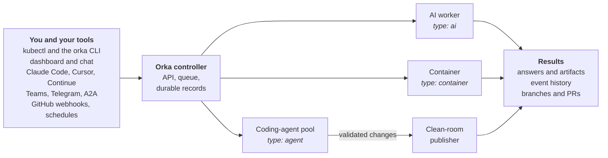

# What is Orka?

Orka runs AI work on Kubernetes. You describe a piece of work as a **Task** — answer a
question, fix a bug and open a pull request, review every pull request in a repository —
and Orka runs it in your cluster, keeps a durable record of what happened, and returns the
result through a REST API, a CLI, a web dashboard, or the chat and editor tools your team
already uses.

Model API keys and Git credentials stay in the cluster. People, CI jobs, and agents get
[scoped client credentials](concepts/security.md#authentication) — Kubernetes
ServiceAccount tokens, OIDC tokens, or transaction tokens — instead, and the platform team
decides which models, tools, and repositories are allowed.

:::tip[See it before you install it]
The [dashboard demo](pathname:///demo/) runs the real Orka dashboard
in your browser on sample data for a fictional company, with a guided tour. Nothing is sent
to a cluster or a model. The [demo videos](demos.md) show the same features on a live cluster.
:::

:::caution[Experimental]
Orka is under active development. APIs, custom resources, and behavior may change between
releases, and it is not yet recommended for production use.
:::

## How it works

Three custom resources cover most of what you write:

| Resource | What it is |
| --- | --- |
| **Provider** | A model backend — Anthropic, OpenAI, Azure OpenAI, or any compatible endpoint — and the Secret that holds its API key. |
| **Agent** | A reusable configuration: model, system prompt, tools, and optionally a coding-agent runtime. A template, not a running process. |
| **Task** | One unit of work. Create a Task to make something happen. |

A Task points at an Agent, and an Agent points at a Provider. A Task has one of three types,
and each type runs somewhere different:

| Type | What runs | Where it runs |
| --- | --- | --- |
| `ai` | Orka's own AI worker, which calls the model in a loop with built-in tools such as web search and code execution | A per-Task Kubernetes Job |
| `agent` | A coding-agent CLI — Codex, Claude Code, GitHub Copilot CLI, or OpenCode — working on a git repository | A warm, controller-owned pool, so later Tasks start in seconds |
| `container` | Any container command. No model involved. | A per-Task Kubernetes Job |

Every Task leaves a record you can come back to: its phase, result, artifacts, logs, and an
event timeline. A coding agent never holds a Git credential. When it changes a repository, a
separate publisher pushes the change and Orka records a verified delivery receipt for the
branch or pull request. [Architecture](concepts/architecture.md) explains the full picture,
and the [Glossary](reference/glossary.md) defines every term.

## What you can do with Orka

### Run AI work

- **Ask a model**, with built-in tools for web search, code execution, URL fetching, and
  file access. [Getting started](getting-started.md#your-first-task)
- **Hand a coding task to an agent.** Codex, Claude Code, Copilot CLI, or OpenCode works on
  a clean checkout, and Orka publishes the branch and pull request.
  [Agent runtimes](concepts/agent-runtimes.md)
- **Run build and test steps** in any container image. [Container tasks](guides/container-tasks.md)
- **Run any Task on a schedule**, with missed-run and overlap rules. [Scheduled tasks](guides/scheduled-tasks.md)
- **Continue a conversation** across Tasks with Sessions. [Session continuity](concepts/agent-runtimes.md#session-continuity)

### Let agents work together

- **Delegate.** A coordinator agent splits work across specialists, within the depth,
  allowlist, and concurrency limits you set. [Multi-agent coordination](guides/multi-agent-coordination.md)
- **Work toward a goal.** An autonomous coordinator plans, delegates, and re-plans across
  iterations until the goal is met. [Autonomous tasks](guides/autonomous-tasks.md)
- **Remember.** Agents propose memories, and people review them before any agent uses them.
  [Memory](concepts/memory.md)

### Automate your repositories

- **Review every pull request** as it arrives and post findings back.
  [Repository monitors](guides/repository-monitors.md)
- **Turn an issue into a pull request** by adding the `orka:implement` label. Planning,
  implementation, review, and repair follow. [Issue-to-PR automation](guides/issue-to-pr-automation.md)
- **Find security issues** with a threat model, validated findings, and remediation pull
  requests. [Security scanning](guides/repository-security-scanning.md)
- **Measure the cost of delivery** as tokens per merged pull request. [Usage and PR outcomes](guides/usage-and-pr-outcomes.md)

### Meet people where they work

- **Chat** with an orchestrator that creates and runs Tasks for you. [Interactive chat](guides/chat.md)
- **Watch and steer work** in the web dashboard. [Web dashboard](guides/ui.md)
- **Script it** with the `orka` CLI. [CLI reference](reference/cli.md)
- **Point Claude Code, Cursor, or Continue at Orka** through OpenAI- and Anthropic-compatible
  endpoints, so nobody needs a provider key. [OpenAI-compatible API](reference/openai-compat.md) ·
  [Anthropic-compatible API](reference/anthropic-compat.md)
- **Reach agents from Microsoft Teams, Telegram, or other agents** over A2A. [Gateways](guides/gateways.md)

### Stay in control

- **Keep credentials away from coding agents.** Their model keys sit behind a proxy, and Git
  credentials go only to the publisher. [Security](concepts/security.md)
- **Approve consequential actions** before they run. [Human approval](guides/human-approval-v2.md)
- **Give agents your own tools** — HTTP APIs and MCP servers — behind outbound access
  policies. [Agents, skills, and tools](guides/agents-skills-and-tools.md)
- **Let people act as themselves** by linking their own GitHub account, with approval on
  every write. [Connectors](guides/connectors.md)
- **Trace everything** with OpenTelemetry and a durable per-Task event history.
  [Observability](guides/observability.md) · [Execution events](reference/execution-events.md)

### Extend Orka

- **Bring your own agent runtime**, such as an [AgentKit](https://github.com/orka-agents/agentkit)
  container or a Microsoft Foundry hosted agent. [Bring your own agent runtime](guides/bring-your-own-agent-runtime.md)
- **Run agents in sandboxes** that suspend, resume, and checkpoint their files.
  [Execution workspaces](concepts/execution-workspaces.md)

## Find your way

| If you want to... | Start here |
| --- | --- |
| Try Orka on a laptop | [Install Orka](operations/installation.md), then [Getting started](getting-started.md) |
| See it working first | [Dashboard demo](pathname:///demo/) and [Demos](demos.md) |
| Copy a working setup | [Examples on GitHub](https://github.com/orka-agents/orka/tree/main/examples) |
| Understand how it fits together | [Architecture](concepts/architecture.md) and [Glossary](reference/glossary.md) |
| Run coding agents with your models | [Provider proxy](operations/provider-proxy.md), then [Agent runtimes](concepts/agent-runtimes.md) |
| Run it for a team | [Security](concepts/security.md), [Configuration](reference/configuration.md), and [Upgrading](operations/upgrading.md) |
| Fix something | [Troubleshooting](operations/troubleshooting.md) and the [Operations runbook](operations/runbook.md) |
| Build on the API | [API reference](reference/api-reference.md) and [API authorization](reference/api-authorization.md) |
| Contribute to Orka | [Development](development/development.md) |

### For agents and automation

If you are an AI agent or a script learning Orka, these pages are the dense ones:

- [Glossary](reference/glossary.md) for the vocabulary, and [Architecture](concepts/architecture.md) for components and lifecycles.
- [Resource reference](reference/resources.md) for every custom resource field.
- [API reference](reference/api-reference.md) and [API authorization](reference/api-authorization.md) for HTTP routes and the permissions each needs.
- [CLI command reference](reference/cli-commands.md) for every command and flag, generated from the binary.
- [Built-in tools](reference/built-in-tools.md) for the tools Orka gives agents and their parameters.

Two rules prevent most surprises. Create resources in the namespace the controller watches
(`orka-system` by default), because resources anywhere else are silently ignored. And treat
a Task as done only when its phase is `Succeeded` — for a coding agent that changes a
repository, `status.delivery` also records the verified result. To work on the Orka source
itself, read [`AGENTS.md`](https://github.com/orka-agents/orka/blob/main/AGENTS.md) in the
repository.

## Ecosystem

These projects live outside the main repository and are versioned separately:

| Project | What it adds |
| --- | --- |
| [orka-gateway-teams](https://github.com/orka-agents/orka-gateway-teams) | Talk to Orka Agents from Microsoft Teams chats and channels. |
| [orka-gateway-telegram](https://github.com/orka-agents/orka-gateway-telegram) | Talk to Orka Agents from Telegram private chats. |
| [orka-gateway-a2a](https://github.com/orka-agents/orka-gateway-a2a) | Call Orka Agents from any [A2A](https://a2a-protocol.org/) client. |
| [agentkit](https://github.com/orka-agents/agentkit) | Build an agent from YAML into a container image, then run it as an Orka runtime. |
| [orka-runtime-foundry](https://github.com/orka-agents/orka-runtime-foundry) | Run Microsoft Foundry hosted agents as Orka runtimes. |
| [orka-integration-kontxt](https://github.com/orka-agents/orka-integration-kontxt) | Issue and exchange [transaction tokens](concepts/transaction-tokens.md) with Kontxt. |
| [orka-integration-agentgateway](https://github.com/orka-agents/orka-integration-agentgateway) | Route [outbound tool calls](concepts/outbound-access.md) through agentgateway. |
| [orka-workspace](https://github.com/orka-agents/orka-workspace) | The shared execution workspace API and its provider controllers. |
| [sessionkit](https://github.com/orka-agents/sessionkit) | Move Codex conversations between machines and Orka. |
| [Vekil](https://github.com/sozercan/vekil) | A model gateway that fronts GitHub Copilot, OpenAI, Anthropic, and others for coding agents. |

## Get involved

Questions, bug reports, and ideas are welcome in
[GitHub issues](https://github.com/orka-agents/orka/issues). To contribute code, start with
[CONTRIBUTING.md](https://github.com/orka-agents/orka/blob/main/CONTRIBUTING.md) and the
[Development](development/development.md) guide. Report vulnerabilities privately as
described in [SECURITY.md](https://github.com/orka-agents/orka/blob/main/SECURITY.md).
